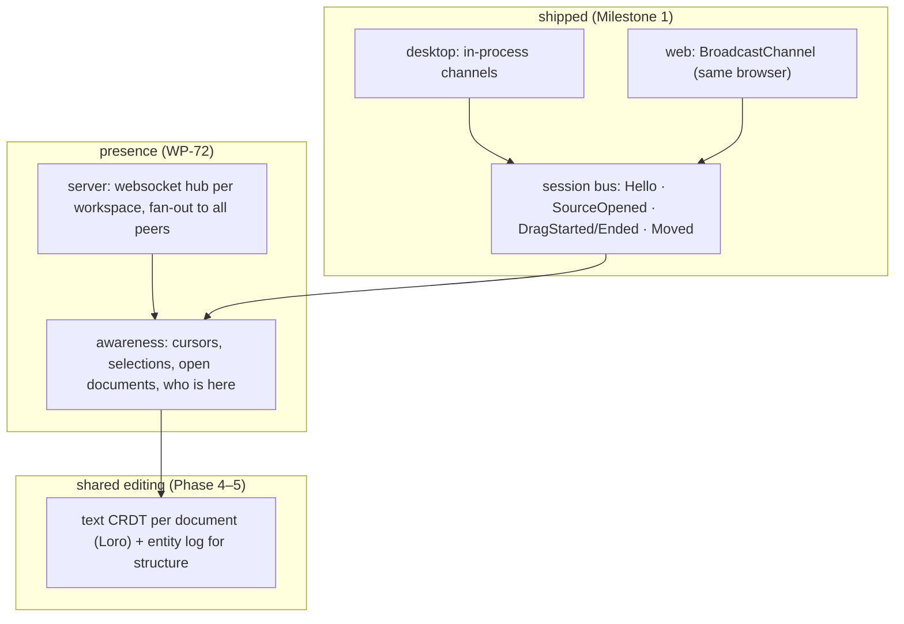

Collaboration in Moonkale grows out of something that already ships: **the session bus**. Every window or tab of one user is a *peer*; a user on another machine is a peer behind the server. Same messages, different transport — so the multi-window feature built in Milestone 1 is the first, zero-latency, single-actor form of collaboration. This note extends it to many people. Related: [[Version Management]] (the entity log is the shared history), [[LLM and RAG]] (agents are peers too).

Several people and agents in one session, and what the database guarantees versus what Moonkale adds when they edit the same graph, are in [[Shared Work]] (2026-10-14).

## Layers



### 1. Session bus (exists)
`moonkale_ext_api::session`: `WindowId`, `SessionMessage`, `trait SessionBus { send }`. A window announces itself (`Hello`), peers reply with their open sources, and documents can be dragged between windows (`DragStarted` → drop target in every other peer → `Moved` → origin closes). The transport is per platform; the messages are serde JSON so they already survive a browser hop (which is why `Version` is serialised as a string — 64-bit hashes don't fit in a JavaScript number).

### 2. Presence / awareness
Small, frequent, **ephemeral** state, never stored in the entity log. The built
wire model is `presence::Member`; account identities and typing indicators remain
later work. Colours come from a stable window palette slot.

```text
Member {
  window, name,
  active: Option<relative document key>,
  line: Option<u32>,       // present only with explicit human cursor sharing
  sharing: Option<{
    updated: milliseconds,
    cursor: Option<{ source, document, line, column, anchor, head }>,
    pointer: Option<{ view, x, y }>,
    agent: Option<(name, cursor)>,
  }>,
}
```

Lines and columns are zero-based; selection offsets and columns use UTF-16,
matching the editor boundary. Graph pointers use finite world coordinates.

- Rendering: other users' carets and selections as decorations in the [[Code Editor]] (the decoration channel already exists for highlights/diagnostics) and as coloured dots on Explorer entries and tabs; a "who's here" list in the status bar.
- Transport: the same session bus, extended with `SessionMessage::Presence { from, member }`; on desktop within one process it is free, across machines it goes through the server hub.
- Cost model: presence is sent on change, throttled (~20 Hz cap), last-write-wins per peer, dropped when stale. Nothing here needs consistency.

### 3. The server as synchronisation hub
[[ADR-0005 Server functions as the remote backend]] already makes `api` the place where sources live for web clients. Collaboration adds one **websocket per (client, workspace)**:

- **Fan-out**: every `SessionMessage`/`Presence` a client sends is relayed to the other clients of that workspace. Desktop clients connect to the same hub when they open a shared workspace ("connect to team server"), so desktop and web users share one session.
- **Authority**: the server owns the sources (folder or database), so it is naturally the serialisation point for writes; today's optimistic `Version` check becomes "the server applies transactions in arrival order and broadcasts the resulting events" — which is exactly the entity log of [[Version Management]] being appended by many actors.
- **Auth and rooms**: workspace = room; users authenticate to the hub; permissions per source (read/write) — the same permission model extensions get ([[Host API Reference]]).
- **Offline/desktop-first**: the local entity log keeps working without a hub; on reconnect, logs merge (structural events commute; content goes through the CRDT).

### 4. Shared editing
Two people typing in the same document need more than versions: a **text CRDT** per document (`loro` or `automerge`, both Rust; Loro's rich-text and tree types map well onto Markdown and flow graphs). Plan:
- `Document.text` becomes a CRDT text; the editor backend applies remote ops as `setText`/splices, local edits become ops. The current whole-document `change` events would be replaced by real splices at this point (P-037).
- The entity log records a `Content` event per CRDT transaction — history stays one log.
- Saving to a folder source writes the merged text; git sees ordinary commits.
- Conflict-free *structure* (adds/removes) is already given by the entity log's set semantics.

## What the multi-window work decided for collaboration
- Messages are **typed Rust enums with serde**, never ad-hoc JSON — so the server hub can be written in the same types.
- A window is identified by a random `WindowId`, a user later by `UserId`; presence uses the pair. Nothing assumes one window per user.
- **Sources are attached by descriptor** (`AttachSource`): a peer that learns of a source can open it without a path — the exact shape a hub needs to hand a newcomer the room's sources.
- Drag-and-drop between windows is a *move* (`Moved` closes the origin) — not a shared edit. The gesture is the workbench **tab** itself (already an HTML5 drag with its id as data). The OS-level drop is used where the platform delivers it; otherwise the offer persists as a **banner** in every other window after `dragend` ("README.md was dragged from another window — Move it here"), so the gesture degrades to grab-then-click instead of failing (P-044). Two windows editing the same document is deliberately unsupported until the CRDT exists; the conflict is caught by the version check on save.

> [!note] Milestone 8: presence exists — `moonkale_server::presence` is a hub with a room per folder id; members carry `{window, name, active document}`; the client publishes on every active-document change and shows others as initials badges (status bar, tabs, Explorer). WP-72 extends this below with opt-in cursor/selection and pointer metadata on both transports. [[Milestone 8 - Implementation Log]].

The current move protocol reloads saved source text. Save an unsaved document before moving it: dirty tabs are not offered. If the origin receives an edit after a clean offer, the move acknowledgement leaves that origin open so the edit remains available. This can leave both windows open on the file; the source version check still governs saving. It does not provide a shared editing transport.

## Open questions (→ [[Problem Ranking]] R-34, R-30)
- Presence for the [[Graph View]]: show other users' viewports/selections on the graph? Probably yes, same channel.
- Agent presence now demonstrates the approved editor.open/ui.reveal target; richer working regions remain in [[Agents in the UI and on the Graph]].
- Hub scale: one Axum task per room with a broadcast channel is enough for teams; beyond that, a message broker.

## Where a shared server stands (2026-09-20)
Modes, what exists and the security model for several people on one server (accounts, roles, the terminal): [[Remote and Server Modes]].


## Position sharing (WP-72, 2026-10-29)

Cursor and graph-pointer switches start off per participant/window and named
session. The title bar has one Sharing disclosure and a visible dot whenever
any position channel is enabled. Its Stop sharing command (default
Ctrl+Shift+Escape, in the effective keymap) revokes cursor, pointer and the
separately enabled demonstration agent cursor, including queued samples.
Nothing is persisted. Session changes and closing the folder revoke sharing.

The existing authenticated server hub carries metadata in `Member.sharing`;
without an external hub, desktop windows carry the same metadata in the scoped
session bus. Rooms include the outer-session id. Movement is coalesced at
50 ms, last write wins; unchanged enabled state gets a five-second heartbeat,
and receivers discard positions after fifteen seconds. Disconnection removes
hub membership; local bus positions expire even if a window disappears.

CodeMirror and the Rust editor show named, theme-coloured carets and selection
ranges only over documents already open in the matching source. They never
receive buffer text. Follow tracks a participant through already-open authorized sources; it can
read a newly visited document from that source, never the provider’s unsaved buffer.
Escape, a local navigation gesture or opening a document cancels it. Positions
remain relative to each receiver's local version; concurrent editing still
needs the CRDT/OT layer below. Cursor announcements are a palette/disclosure
command, never a live narration of every movement. Sharing a pointer is
independent of sharing a caret.

The 2D graph pointer is a labelled, optional arrow in world coordinates. A
receiver projects it through its own camera every frame, including zoom/pan.
Only matching graph source/scope/filter views display it; 3D pointers remain
hidden rather than guessing a depth. It has no action or input authority.
The approved agent `editor.open` / `ui.reveal` target supplies the demonstration
agent's position, through the same channel and its own explicit cursor switch.
AU-12 keyboard grants still require accounts (SW-02) and remain later work.

Transport backpressure keeps a single latest outgoing snapshot, so revocation replaces queued motion. The web link uses a bounded wake queue; native hub links use watch channels for outgoing state and incoming member lists. Application queues do not retain a movement history.
