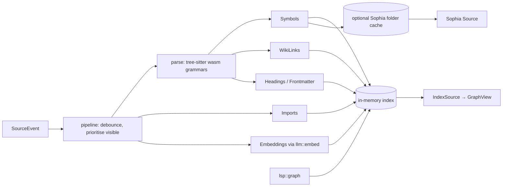

Crate: `index`. The index turns *files and rows* into a *graph* by deriving what sources don't know: symbols, links, outlines, embeddings, stack frames. It is exposed as `IndexSource`, so its output is just more nodes and edges.

> [!note] Index rechecked 2026-10-24 (WP-21/WP-65/WP-22/WP-66)
> - **Extractors**: wiki-links and tree-sitter definitions for Rust, Julia and Python. The three languages run through the same dispatch. Definitions have location ids, names, ranged occurrences, lexical containment and provenance; syntactic calls/references/imports resolve unique same-file names and preserve other targets as `Unresolved`. See [[Code Graph Schema]] for exact coverage and limitations. No headings/front matter nodes yet.
> - **Parsing** is native tree-sitter through `arborium` (shared with the Rust code editor, P-113) — not `.wasm` grammars; the index runs on desktop and the server, and the web/phone query the server's.
> - **Default storage is memory**: graph, BM25 postings (`search.rs`) and embeddings (brute-force cosine, reciprocal-rank fusion) rebuild on open. Default-off `sophia` now adds a derived SQLite code store per folder, reused on reopen (below; ADR-0029). No tantivy, usearch or recoco dependency.
> - **Content identities**: experimental `moonkale-index/content-ids`, off by default. Explicit async requests hash normalized Rust/Julia/Python syntax and same-file recursive dependencies; a bounded memory cache and optional state-store adapter are available. Unsupported syntax fails explicitly. No eager workspace hashing or UI activation. See [[Code Graph Schema]] for normalizer v7 and its conservative syntax subset.
> - **Rust L1 foundation**: default-off `lossless-syntax` snapshots preserve exact bytes/trivia and return guarded pure patch plans. The separate default-off `structural-edits` host feature now connects these plans to revision-aware document buffers and graph preview/conflict controls on desktop/web, plus complete same-folder reference-aware Rename via the existing LSP manager (coordinated buffer history, separate per-file saves); see [[Rust Lossless Syntax and Patches]].
> - **LSP as a second extractor** and the `precision` field are not built.
> - Stack traces live in their own crate, `moonkale-trace` (`TraceSource`), not in `index::trace`.

## Sophia folder cache (WP-21, implemented 2026-10-24)

With the default-off `sophia` feature, opening a folder writes the index's code
records into `.moonkale/code.sophia` (SQLite, enforced derived mode). The existing
in-memory index and its search remain available. The extra Sophia Source offers
names, definitions, references, generic Calls, SQL and Sophia queries to the
graph view and agent. It is read-only and declares file truth (ADR-0029).

Only the index's admitted Rust/Julia/Python code enters it: not hidden or
ignored, under 512 KiB per file; 5,000 walked files and 64 MiB aggregate bound.
Metadata files are read only for naming, never copied into the store. The walk
explicitly excludes `.moonkale/`; the cache adds its own ignore file.
Reopen hashes text against manifests and skips unchanged code without parsing
or ingesting it. Julia uses the shared module/include resolver; its dependants
are recomputed when needed and only changed manifests are written. Rust uses
nearest Cargo package names and conventional file modules; Python uses package
roots. Nonstandard Rust `#[path]` / custom target module trees are not inferred
by this first writer. Shared naming and content-id limits remain authoritative.

One watcher debounce window crosses `Source::refresh_batch` and the server
proxy intact, then becomes one `replace_files` transaction, including both
sides of a rename. Structured name conflicts add owners with a 16-owner bound;
empty/repeated owners fail visibly. Normalizer mismatch rebuilds the derived
cache. Removing it loses no authored content. Sophia manifest @1 owns facts
and their per-file reference counts, including atomic rollback.

The adapter checks current file hashes on text fetch. Matching definitions use
exact source spans; stale spans fall back to the current whole file and mark
the path stale. No reprinted code is written back. A derived reader reopens
its cache connection per call so it can follow cache recreation. Rebuilding
preserves definition content ids and names; generic nominal ids are allocated
by Sophia and may change. This does not yet make Sophia the default backend
or complete ADR-0029's release/default gates.

Rust acceptance tests live in `packages/services/index/tests/folder_store.rs`;
producer/mapping details in `packages/services/index/index.md`, reader details
in `packages/sources/sophia/sources-sophia.md`. Reproduce the repository
measurement with `cargo run -p moonkale-index --example folder_store --features
sophia -- .` (native debug; reads current working-tree code).

## Decisions
- **tree-sitter grammars as `.wasm`** — one artefact for desktop, web and mobile; contributed by language extensions ([[Contribution Points]]).
- **Two symbol extractors**: tree-sitter (fast, always available, approximate) and LSP (precise, needs a server). Derived edges carry `precision`; views prefer LSP when both exist.
- **Incremental by node**: a change re-runs extractors for that node only and re-links only its edges. Priority goes to nodes that are visible in some editor.
- **Storage is native/server**: `tantivy` + `usearch` don't target the browser; the web build queries the server's index. Parsing still runs client-side for highlighting.
- **Sophia** is the persisted code graph and query engine (ADR-0029). Recoco/Thread remain requirements prior art, not pipeline dependencies.

## Stack traces and ASTs
`index::trace` parses rustc/Julia/Go/Python trace formats into `Frame` nodes with `Calls` edges, linked to `Symbol` nodes. A panic in the [[Terminal]] becomes a clickable subgraph in the [[Graph View]] with a hierarchical layout. Function ASTs are the tree-sitter tree exposed as a `GraphView` (nodes = syntax nodes) — free once parsing exists.

## Embeddings and RAG
See [[LLM and RAG]]. Chunking is per symbol / heading / row; vectors are stored locally (`usearch`) or in the source when it has `VECTOR` (`pgvector`, HelixDB). Hybrid search = BM25 (`tantivy`) ∪ vector, fused.

## WP-21 repository measurement (2026-10-24)

Measured on this Linux worktree at master `9bedc5ab` plus WP-21, native **debug**
build, Sophia `c3c48e02`, fresh cache, owned target/slot and shared benchmark lock. The example reopens the
folder Source and rereads code on both passes; these are folder-store times,
not full UI startup times. Browser servers were stopped for the measurement.

| pass | total | walk/read snapshot | hash/produce/store | store size | parsed / replaced / skipped |
|---|---:|---:|---:|---:|---|
| cold build | 8.830 s | 0.729 s | 8.101 s | 36,704,256 bytes | 478 / 478 / 0 |
| reopen | 0.664 s | 0.635 s | 0.030 s | 36,704,256 bytes | 0 / 0 / 478 |

The snapshot was 6,111,526 source bytes. The cold pass added 4,962 distinct
records, 5,552 names, 3,740 memberships and three generic-call facts. It refused
2,787 definitions outside the conservative normal form and reported 12 ambiguous
named bindings (including conditional `SERVICES` definitions). Ambiguous names
are omitted rather than arbitrarily choosing a conditional branch; records
remain available. `folder_store_report` and the index root's
`sophia_refused` / `sophia_naming_diagnostics` properties report such partial
coverage. Timing columns are rounded independently. These are observations, not performance assertions or proof of full
repository/compiler coverage. Evidence: `target/next17-measured-final.log`.

Verification: all 18 mandatory/feature gate commands passed in
`target/next17-verified-gates.log` (826 workspace tests, seven ignored;
73 feature-focused tests, including ten folder-store regressions). Browser
`sophia-folder`, `graph`, `watch` and `search-trace` pass with the feature enabled
on owned port 8117; the renderer suites use Chromium/SwiftShader.
