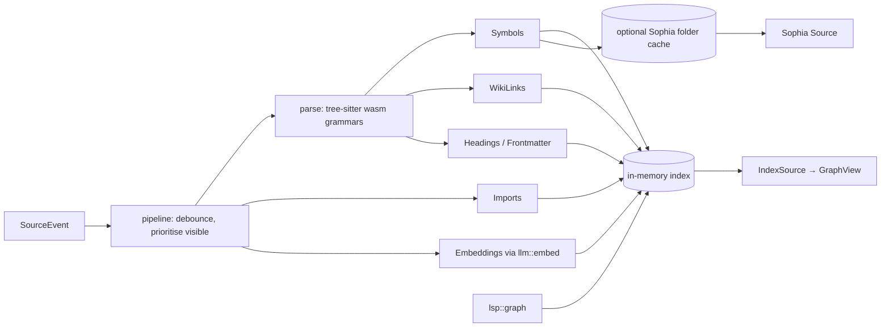

Crate: `index`. The index turns *files and rows* into a *graph* by deriving what sources don't know: symbols, links, outlines, embeddings, stack frames. It is exposed as `IndexSource`, so its output is just more nodes and edges.

> [!note] Index storage rechecked 2026-10-27 (ADR-0030); extractor coverage from 2026-10-24 (WP-21/WP-65/WP-22/WP-66)
> - **Extractors**: wiki-links and tree-sitter definitions for Rust, Julia and Python. The three languages run through the same dispatch. Definitions have location ids, names, ranged occurrences, lexical containment and provenance; syntactic calls/references resolve unique same-file names and explicit folder imports (WP-22, 2026-10-28), preserving other targets as `Unresolved`. See [[Code Graph Schema]] for exact coverage and limitations. No headings/front matter nodes yet.
> - **Parsing** is native tree-sitter through `arborium` (shared with the Rust code editor, P-113) — not `.wasm` grammars; the index runs on desktop and the server, and the web/phone query the server's.
> - **Default code graph reads use Sophia** in files-truth folders on desktop/mobile and the server. The in-memory graph, BM25 postings (`search.rs`) and embeddings (brute-force cosine, reciprocal-rank fusion) rebuild on open; search and explicit/fallback graph reads use them. Marked store-truth folders use the read-only stopgap below. No tantivy, usearch or recoco dependency.
> - **Content identities**: experimental `moonkale-index/content-ids`, off by default. Explicit async requests hash normalized Rust/Julia/Python syntax and same-file recursive dependencies; a bounded memory cache and optional state-store adapter are available. Unsupported syntax fails explicitly. No eager workspace hashing or UI activation. See [[Code Graph Schema]] for normalizer v7 and its conservative syntax subset.
> - **Rust L1 foundation**: default-off `lossless-syntax` snapshots preserve exact bytes/trivia and return guarded pure patch plans. The separate default-off `structural-edits` host feature now connects these plans to revision-aware document buffers and graph preview/conflict controls on desktop/web, plus complete same-folder reference-aware Rename via the existing LSP manager (coordinated buffer history, separate per-file saves); see [[Rust Lossless Syntax and Patches]].
> - **LSP as a second extractor** and the `precision` field are not built.
> - Stack traces live in their own crate, `moonkale-trace` (`TraceSource`), not in `index::trace`.

## Folder truth (ADR-0030, implemented 2026-10-27)

Opening a folder detects `.moonkale/truth.json`: `{"truth":"store","since":"2026-10-27"}`
means store truth; no marker (or explicit `truth: files`) means file truth. The
folder and index descriptors carry this mode. The shared folder detector bounds
the JSON to 4 KiB and refuses invalid, unreadable or linked metadata; it never
silently authorizes cache disposal when metadata cannot be trusted. See
[[ADR-0030 Where the truth lives]] for the format and future migration commands.

The status bar and explorer root show “Truth: files” or “Truth: Sophia store”
in English, German and Chinese. The status item follows the active document or
Explorer selection, falling back to the first folder. Its tooltip lists each
open folder’s name, truth, backend and fallback/read-only reason.
Until SPEC-010 is implemented, marked folders
show “Code graph read-only: store editing is not available yet”. Their graph and
search read the in-memory index; the code store is left untouched. Plain file
editing remains available, without propagating changes into the authoritative
store. There is no marker-creation or truth-move command yet.

`FolderStore` refuses all writer/check/repair entry points for store truth,
before SQLite is opened or any store/sidecar/ignore file is created or removed.
This covers automatic broken-cache repair, manual **Check the cache** and
normalizer changes, even when the existing store is unreadable. The writer
retains store truth and rechecks the marker on each entry point. The cache
behavior below applies only to files-truth folders.

Verification (2026-10-27): all AGENTS gates pass, with 871 workspace tests
(seven ignored). The focused project-fs/index/Sophia run passes 118 tests,
including 18 folder-store regressions; `sophia-folder` passes with unmarked
and marked-folder status/explorer assertions and corrupt-store preservation.
Logs: `target/next21-gates.log`, `target/next21-focused-final.log`,
`target/next21-final-checks.log` and `target/next21-browser.log`.

## Sophia folder cache (WP-21, implemented 2026-10-24)

With `sophia` enabled by default on desktop/mobile and by the server feature, opening a files-truth folder writes the index's code
records into `.moonkale/code.sophia` (SQLite, enforced derived mode). The existing
in-memory index and its search remain available. The extra Sophia Source offers
names, definitions, references, generic Calls, SQL and Sophia queries to the
graph view and agent. It is read-only and declares file truth (ADR-0029).

Only the index's admitted Rust/Julia/Python code enters it: not hidden or
ignored, under 512 KiB per file; 5,000 walked files and 64 MiB aggregate bound.
Metadata files are read only for naming, never copied into the store. The walk
explicitly excludes `.moonkale/`; the cache adds its own ignore file.
Reopen hashes text against manifests and skips unchanged code without parsing
or ingesting it. Julia uses the shared module/include resolver; its dependants
are recomputed when needed and only changed manifests are written. Rust uses
nearest Cargo package names and conventional file modules; Python uses package
roots. Nonstandard Rust `#[path]` / custom target module trees are not inferred
by this first writer. Shared naming and content-id limits remain authoritative.

One watcher debounce window crosses `Source::refresh_batch` and the server
proxy intact, then becomes one `replace_files` transaction, including both
sides of a rename. Structured name conflicts add owners with a 16-owner bound;
empty/repeated owners fail visibly. Normalizer mismatch rebuilds the derived
cache. Removing it loses no authored content. Sophia manifest @1 owns facts
and their per-file reference counts, including atomic rollback.

The adapter checks current file hashes on text fetch. Matching definitions use
exact source spans; stale spans fall back to the current whole file and mark
the path stale. No reprinted code is written back. A derived reader reopens
its cache connection per call so it can follow cache recreation. Rebuilding
preserves definition content ids and names; generic nominal ids are allocated
by Sophia and may change. ADR-0030 makes this the default for legacy code graph reads; search remains in memory.

`code_graph.source` in the regular user/workspace settings store selects
`auto` (default) or `in-memory`. The graph's bounded `code-graph` query envelope
carries this preference per request; it never changes search or another client's
choice. The index delegates code graph queries to its read-only Sophia adapter.
File/note nodes and wiki-links remain index-owned; Local code-file queries use
manifest spans to reach stored definitions. The status bar always names the
backend, including an explicit reason for fallback. A cache directory/open,
sync or read error preserves the current index. A corrupt database is rebuilt
once per open; an authored store at the reserved path is never deleted.

**Check the cache** in the command palette takes a new bounded, ignore-aware
snapshot of current files, builds a fresh store in a temporary directory under
`.moonkale/`, and compares the shared `folder_store::digest` full-digest-v1
implementation used by the history replay. It checks manifests, names, live
generic memberships, canonical record bytes, text pointers and facts. A fresh
cache reports `same`; differences name keys, rebuild the cache, and file a
problem in the runtime log and status notification. Temporary stores are cleaned
on return. Cache export awaits SPEC-010's text form.

Rust acceptance tests live in `packages/services/index/tests/folder_store.rs`;
producer/mapping details in `packages/services/index/index.md`, reader details
in `packages/sources/sophia/sources-sophia.md`. Reproduce the repository
measurement with `cargo run -p moonkale-index --example folder_store --features
sophia -- .` (native debug; reads current working-tree code).

## Decisions
- **tree-sitter grammars as `.wasm`** — one artefact for desktop, web and mobile; contributed by language extensions ([[Contribution Points]]).
- **Two symbol extractors**: tree-sitter (fast, always available, approximate) and LSP (precise, needs a server). Derived edges carry `precision`; views prefer LSP when both exist.
- **Incremental by node**: a change re-runs extractors for that node only and re-links only its edges. Priority goes to nodes that are visible in some editor.
- **Storage is native/server**: `tantivy` + `usearch` don't target the browser; the web build queries the server's index. Parsing still runs client-side for highlighting.
- **Sophia** is the persisted code graph and query engine (ADR-0029). Recoco/Thread remain requirements prior art, not pipeline dependencies.

## Stack traces and ASTs
`index::trace` parses rustc/Julia/Go/Python trace formats into `Frame` nodes with `Calls` edges, linked to `Symbol` nodes. A panic in the [[Terminal]] becomes a clickable subgraph in the [[Graph View]] with a hierarchical layout. Function ASTs are the tree-sitter tree exposed as a `GraphView` (nodes = syntax nodes) — free once parsing exists.

## Embeddings and RAG
See [[LLM and RAG]]. Chunking is per symbol / heading / row; vectors are stored locally (`usearch`) or in the source when it has `VECTOR` (`pgvector`, HelixDB). Hybrid search = BM25 (`tantivy`) ∪ vector, fused.

## WP-21 repository measurement (2026-10-24)

Measured on this Linux worktree at master `9bedc5ab` plus WP-21, native **debug**
build, Sophia `c3c48e02`, fresh cache, owned target/slot and shared benchmark lock. The example reopens the
folder Source and rereads code on both passes; these are folder-store times,
not full UI startup times. Browser servers were stopped for the measurement.

| pass | total | walk/read snapshot | hash/produce/store | store size | parsed / replaced / skipped |
|---|---:|---:|---:|---:|---|
| cold build | 8.830 s | 0.729 s | 8.101 s | 36,704,256 bytes | 478 / 478 / 0 |
| reopen | 0.664 s | 0.635 s | 0.030 s | 36,704,256 bytes | 0 / 0 / 478 |

The snapshot was 6,111,526 source bytes. The cold pass added 4,962 distinct
records, 5,552 names, 3,740 memberships and three generic-call facts. It refused
2,787 definitions outside the conservative normal form and reported 12 ambiguous
named bindings (including conditional `SERVICES` definitions). Ambiguous names
are omitted rather than arbitrarily choosing a conditional branch; records
remain available. `folder_store_report` and the index root's
`sophia_refused` / `sophia_naming_diagnostics` properties report such partial
coverage. Timing columns are rounded independently. These are observations, not performance assertions or proof of full
repository/compiler coverage. Evidence: `target/next17-measured-final.log`.

Verification: all 18 mandatory/feature gate commands passed in
`target/next17-verified-gates.log` (826 workspace tests, seven ignored;
73 feature-focused tests, including ten folder-store regressions). Browser
`sophia-folder`, `graph`, `watch` and `search-trace` pass with the feature enabled
on owned port 8117; the renderer suites use Chromium/SwiftShader.

## SPEC-010 acceptance 2: the truth moves into the store halfway (2026-10-28)

Sophia v0.1.5 (`686f8e0`; the runs used `08e6ffb`, the same code). `MOONKALE_REPLAY_TRUTH_AT=half
history_replay REPO RANGE SCRATCH` replays the first half as a derived cache.
Then the replayed store and a twin built fresh at the same commit both call
`take_truth`. The later commits are appended to both through
`FolderStore::append_selected`, which writes with `replace_files_checked` and
the tokens from `file_token`, so every version stays. Each later checkpoint
compares the replay with the twin and with a fresh derived build (full-digest-v1).
At the end the replay calls `give_truth` with every current file, and must then
equal a fresh build, record count included.

| repository | commits | switch | checkpoints | differences | errors / retries | records before → after give_truth (fresh) |
|---|---:|---:|---:|---:|---:|---|
| lenticulum (→ `488ce636`) | 130 | 65 | 4 | 0 | 0 / 0 | 2,473 → 1,770 (1,770) |
| moonkale (→ `44c40663`) | 471 | 236 | 11 | 0 | 0 / 0 | 7,840 → 5,940 (5,940) |

The store-truth Moonkale store grows to 64,995,328 bytes with its history (it is
41.4 MB derived). The raw reports are
`packages/services/index/measurements/history-2026-10-28-{lenticulum,moonkale}-spec010.jsonl`.
The hermetic five-commit test also switches after commit 3.

**Rerun on Sophia v0.1.6** (`e84baa3`, 2026-10-28: fixes from Codex's review of
SPEC-010): the same counts, 0 differences and 0 errors in both histories. Raw
reports: `history-2026-10-28-{lenticulum,moonkale}-v0.1.6.jsonl`.

**Rerun on Sophia v0.1.7** (`5310d80`, 2026-10-29: fixes from a second Codex
review of SPEC-010): the same counts again, 0 differences and 0 errors in both
histories. Raw reports: `history-2026-10-29-{lenticulum,moonkale}-v0.1.7.jsonl`.

## ADR-0029 gate 4: history replay (2026-10-24)

**Current: Sophia v0.1.4** (`919d723`, 2026-10-26): `replace_files` refuses
records that none of the file's names, spans or generic memberships reach
(`StoreError::UnreachedRecord`, Sophia RQ-002), so a derived store can't drift
from a fresh build. Replayed on its code (`dcf8660`): 0 UnreachedRecord errors,
0 differences, Moonkale 5,940 records / 41,422,848 bytes; raw reports
`history-2026-10-26-{moonkale,lenticulum}-v0.1.4.jsonl`.

Sophia v0.1.3 (`79f6429`, 2026-10-25): in derived stores, facts
no longer keep records alive, and a file listing a generic twice counts once.
Replayed again on v0.1.3: 0 differences, Moonkale 41,467,904 bytes, All(1000)
43.5 ms debug; raw reports `history-2026-10-25-{moonkale,lenticulum}-v0.1.3.jsonl`.
The table below is v0.1.2 (`3c4b4a9`; the replays ran on `7680bed`, the same
code without the version bump). It adds folder-store garbage collection (Sophia
SR-146: `replace_files` removes what only the batch's old manifests reached) and
the P-232 fixes. Both histories: **0 differences**, 0 errors, 0 retries.

| repository | commits | batch median / p95 | sum of batch times | final store bytes | records / live facts | All(1000) median / p95 | text_source median |
|---|---:|---:|---:|---:|---:|---:|---:|
| moonkale (→ `44c40663`) | 471 | 72.5 / 552.5 ms | 78.6 s | 41,472,000 | 5,940 / 3 | 43.1 / 44.4 ms | 2.39 ms |
| lenticulum (→ `488ce636`) | 130 | 215.2 / 1097.5 ms | 52.8 s | 11,390,976 | 1,770 / 408 | 13.6 / 14.5 ms | 0.71 ms |

Against v0.1.1 over the same ranges: Moonkale's store shrinks from 92.6 to
41.5 MB (fresh build 36.9 MB), batch times are unchanged within noise, and
All(1000) drops from 6.2 s to 43 ms in debug (release: 1.85 s to 16 ms, by
`query_profile`). Raw reports:
`packages/services/index/measurements/history-2026-10-24-{moonkale,lenticulum}-v0.1.2.jsonl`.

**Rerun with the P-231 fix: clean.** Sophia `77f5c1c9` (tagged v0.1.1,
`def22b0c`, now pinned) fixes both causes of P-231: duplicate old member ids, and
names changing kind. With the same tool, checker `full-digest-v1` and debug
build, both histories show **0 differences at every checkpoint**, with no write
or fresh-build errors and no retries:

| repository | commits | batch median / p95 | sum of batch times | final store bytes | records / live facts |
|---|---:|---:|---:|---:|---:|
| moonkale (→ `edcf3c86`) | 469 | 122.1 / 932.9 ms | 119.6 s | 92,475,392 | 11,536 / 3 |
| lenticulum (→ `488ce636`) | 130 | 187.3 / 1089.2 ms | 49.3 s | 20,258,816 | 2,775 / 408 |

Final-checkpoint reads (median / p95 ms): Moonkale lookup 0.009 / 0.010,
text_source 4.78 / 5.95, All(1000) 6180 / 6226; Lenticulum lookup 0.006 / 0.007,
text_source 1.37 / 1.46, All(1000) 128.0 / 128.7. The All(1000) growth is
unchanged by the fix; the P-232 profile below identifies its upstream cause. Raw reports:
`packages/services/index/measurements/history-2026-10-24-{moonkale,lenticulum}-77f5c1c9.jsonl`.
The run header now names the Sophia source from Cargo.lock.

### All(1000) profile: P-232 (2026-10-24)

The delay is in **Sophia's namespace reads**. The opt-in adapter timing now
separates `Interface::all` from generic-call expansion; node/edge conversion
remains a separate span. The new `sources/sophia` example `query_profile`
reproduces both the Interface and Source reads, then probes individual nodes,
namespace children and ReadTx prefix operations. No production query semantics,
Sophia dependency pin or default backend changed.

The measurements use disposable copies of the kept **v0.1.1 (`def22b0c`)**
stores, rather than replaying history again: Moonkale's 471-commit replay
through `44c40663` (11,541 definitions, 5,569 names, 15,951 metadata rows), and
Lenticulum's 130 commits through `488ce636` (2,775 / 1,011 / 4,654).
Linux, Rust 1.98.1, native debug and release, own `target/agent`, heavy slot and
shared bench lock, after builds/checks finished. Run 0 warms each phase;
medians below use runs 1–5. These diagnostic probes are separate operations,
not exclusive subspans to add together.

| phase (median ms) | Moonkale debug | Moonkale release | Lenticulum debug | Lenticulum release |
|---|---:|---:|---:|---:|
| Source total | 6226.105 | 1847.296 | 126.209 | 31.962 |
| Sophia all (Source span) | 6221.367 | 1845.872 | 122.008 | 30.404 |
| Generic-call expansion | 0.024 | 0.012 | 0.017 | 0.010 |
| Adapter conversion | 3.017 | 0.915 | 2.915 | 1.017 |
| Interface all (direct probe) | 6174.008 | 1825.720 | 120.975 | 29.582 |
| Individual nodes (probe) | 604.355 | 123.697 | 15.245 | 5.191 |
| Namespace children (probe) | 5595.927 | 1701.048 | 104.916 | 24.901 |
| Metadata prefixes (probe) | 4353.745 | 1408.430 | 81.618 | 18.072 |
| Names under prefix (probe) | 592.313 | 120.335 | 8.684 | 1.852 |
| Names from prefix (probe) | 541.570 | 103.005 | 8.693 | 1.939 |

`Interface::all` first builds Contains edges, then asks `edges_at(Out)` for each
retained namespace. That calls `children_in`, rebuilds child views and Contains
edges, and finally `all` discards those edges through its dependency filter.
The Moonkale answer has **1,000 namespaces, no definitions/names, 999 Contains
edges**, and is truncated; generic-call expansion therefore has no subjects.
The namespace child probes construct 4,871 children, despite the answer's cap.
Lenticulum's same-sized answer has only 74 namespaces; its child probes build
1,085 children. Namespace count and metadata-table size explain the difference
in work despite the identical 1,000-node cap.
No text rendering or per-definition lookup is needed for this answer.

`children_in` calls `meta_prefix` once per namespace. Its SQLite `substr`
predicate scans all metadata; EXPLAIN reports `SCAN t_meta`. The corresponding
1,000 prefix probes return **zero rows** yet take most of the all-read time.
`namespace_exists` also uses `names_under(path, 2)`, whose OR predicate reports
`SCAN t_name`. `names_from` instead reports an indexed primary-key search.
The metadata/file-manifest scan explains why deleting historical definitions
alone did not remove the delay.

**Before/after:** the slow read is reproduced and localized; it remains
unfixed upstream. Moonkale's change only adds diagnostic spans and the example,
so there is no post-fix speedup to report. The exact upstream request is in
`HANDOFF-from-codex.md`: avoid namespace dependency expansion whose edges are
immediately discarded; make metadata and namespace-existence prefix reads
indexed; preserve graph semantics and add operation-count/query-plan tests.
See [[P-232 Sophia capped graph reads scan namespace metadata]].

Reproduce on a disposable copy with
`MOONKALE_GRAPH_PROFILE=1 cargo run [--release] -p moonkale-sources-sophia --example query_profile -- <copy.sophia>`
(use `--release` for the optimized build). Raw samples and SQL query plans:
[query-profile-2026-10-24.txt](https://github.com/MathStruct/Moonkale/blob/master/packages/services/index/measurements/query-profile-2026-10-24.txt).
All AGENTS gates and feature-specific index/Sophia tests/clippy pass; this
profiling-only change has no browser UI surface.

The v0.1.0 run below is kept as the evidence for P-231.

### First run, Sophia v0.1.0

The opt-in `history_replay` example runs behind `sophia`; its shared test helper
also drives the hermetic five-commit CI test. Both real repositories were read
through Git blobs, without checkout or writes to either repository or Sophia's
checkout. Owned scratch/target directories, the heavy slot and the shared bench
lock were used. Native debug build, Sophia **v0.1.0 (`c3c48e02`)**, normalizer v7,
Linux, Rust 1.98.1. These are observed timings, not performance assertions.
Compilation/checks were excluded from the measured runs.

Each adjacent tree in reverse topological order is one watcher-shaped
`sync_selected` window, using the production `replace_files`/`NameClaimed`
retry path. The full eligible snapshot supplies dependency/owner recovery.
Only regular Rust/Julia/Python blobs and naming/ignore metadata are materialized;
the ordinary ignore-aware Source walk selects the code. Limits remain 512 KiB
per file, 5,000 walked files and 64 MiB admitted code. Unsupported/hidden/ignored
files, symlinks and internal cache/build directories do not enter the store.
This measures the folder writer, not OS event delivery or full app startup.
Equivalence checks consistency within today's conservative producer, not full
compiler-level definition/extraction coverage.

At every 50 commits and the end, a separate snapshot/store is built fresh.
Comparison covers full content ids/canonical bytes, actual names, text-source
pointers, file manifests, live generic memberships (including orphan relations),
and facts even on historical record subjects. Immutable historical records,
logs, randomly allocated nominal ids and first-writer display labels are
excluded from equivalence. Record counts below include retained history;
fact counts count actual live facts, not manifest claims. Differences are
reported without repairing or resynchronizing the incremental store.

| repository | commits | batch median / p95 | sum of batch times | retries | final store bytes | retained records / live facts | checkpoint differences / write or fresh-build errors |
|---|---:|---:|---:|---:|---:|---:|---:|
| moonkale | 467 | 105.462 / 795.053 ms | 106.232 s | 0 | 92,307,456 | 11,514 / 3 | 10 / 0 |
| lenticulum | 130 | 200.187 / 1193.086 ms | 54.676 s | 0 | 20,254,720 | 2,775 / 408 | 35 / 0 |

Ranges and evidence (JSONL contains every commit, count, error, difference and checkpoint timing):

- **moonkale**: `master`, `0bf404d7b42f998a06a3b28f09e1cf5b84df59f0` → `6d2afa4aaf2c63a8f501518747b4137acf3a5ee4`; [raw report](https://github.com/MathStruct/Moonkale/blob/master/packages/services/index/measurements/history-2026-10-24-moonkale.jsonl).
- **lenticulum**: `HEAD`, `6267a1576ec1d055572cdafb370903f018e7c31d` → `488ce636f193f95afb5ccbbbf92d34ea711e5e2a`; [raw report](https://github.com/MathStruct/Moonkale/blob/master/packages/services/index/measurements/history-2026-10-24-lenticulum.jsonl).

Checkpoint queries use 100 name resolutions, 100 fixed-seed random definition
`text_source` reads with replacement (seed `4d6f6f6e6b616c65`), and ten graph
`Source::query(All { limit: 1000 })` reads. Each cell below is median / p95 in
milliseconds. p95 uses nearest rank. Empty stores have no lookup/text samples.
These graph reads are capped snapshots, not whole-store traversal timings.

| repository / checkpoint | name lookup | text_source | graph All(1000) |
|---|---:|---:|---:|
| moonkale / 50 | 0.006 / 0.007 | 0.859 / 0.936 | 503.495 / 511.265 |
| moonkale / 100 | 0.007 / 0.007 | 1.076 / 1.176 | 745.031 / 747.243 |
| moonkale / 150 | 0.006 / 0.007 | 1.318 / 1.380 | 1070.522 / 1074.204 |
| moonkale / 200 | 0.007 / 0.007 | 1.464 / 1.537 | 1225.233 / 1231.006 |
| moonkale / 250 | 0.007 / 0.007 | 2.433 / 2.574 | 2734.605 / 2749.230 |
| moonkale / 300 | 0.007 / 0.007 | 2.522 / 2.669 | 2895.382 / 2949.424 |
| moonkale / 350 | 0.007 / 0.008 | 2.826 / 3.023 | 3310.263 / 3356.621 |
| moonkale / 400 | 0.009 / 0.010 | 4.592 / 5.891 | 5986.299 / 6013.897 |
| moonkale / 450 | 0.009 / 0.010 | 5.004 / 6.206 | 6161.308 / 6257.106 |
| moonkale / 467 | 0.009 / 0.010 | 4.782 / 6.017 | 6240.104 / 6372.789 |
| lenticulum / 50 | 0.006 / 0.007 | 0.754 / 0.787 | 67.256 / 68.306 |
| lenticulum / 100 | 0.006 / 0.007 | 1.205 / 1.318 | 110.904 / 111.521 |
| lenticulum / 130 | 0.007 / 0.007 | 1.357 / 1.458 | 127.903 / 129.483 |

The actual Search-panel read (`Text { dialect: "search", text: "main" }`,
ten attempts per checkpoint) is **unsupported** by SophiaSource. The raw reports
record its rejection latency and error; these are not successful search
measurements. Graph-read errors, if any, are separate checkpoint fields.
Search still uses the existing in-memory index, not this Sophia read path.

**Findings — gate 4 remains unmet.** P-231 affects both Rust and Julia:
Sophia deduplicates new generic contributions by content id but subtracts
repeated old manifest ids without deduplicating. Live generic names/members
can disappear even though file manifests agree. Old nominal relations can also
remain orphaned after a name becomes Content; that transition needs upstream
review. The exact request is in `HANDOFF-from-codex.md`; a minimal ignored
contract regression fails on v0.1.0. No cache repair or workaround is included.

Checkpoint difference counts are counts of differing state keys, not independent
bugs (a missing generic can affect its name and membership, and a persistent
error can recur at later checkpoints). Exact commits and owning paths are in
the raw reports. Differing checkpoints:

- moonkale #300 `2fe0c7f216c965f90ac2241a3494072d540f5071`: 2 differing keys.
- moonkale #350 `5a2cb07de26b793e0ad29ee18d3f589d2a679242`: 2 differing keys.
- moonkale #400 `48d17bff874a2fabd94e35202592135568280ad4`: 2 differing keys.
- moonkale #450 `02bf57ba285c537a18fb9bc0730966488defe27f`: 2 differing keys.
- moonkale #467 `6d2afa4aaf2c63a8f501518747b4137acf3a5ee4`: 2 differing keys.
- lenticulum #50 `cf7e331b23fb3464004ac8b1cd4ab36a97a85fc4`: 1 differing keys.
- lenticulum #100 `53b8b15b29ce0cf0698d4f7cc99271fbac3332ac`: 10 differing keys.
- lenticulum #130 `488ce636f193f95afb5ccbbbf92d34ea711e5e2a`: 24 differing keys.

All reported differences are name/membership keys: Moonkale has five missing
name keys and five missing membership keys across its checkpoints; Lenticulum
has 13 name and 22 membership differences. No content-record, manifest,
text-source or stored-fact differences were observed. A `paths=[]` orphan has
no current owning file manifest; its full member id and commit remain in the
report. The orphan is already present at Lenticulum checkpoint 50.

The fixed graph read gets slower across Moonkale's replay: median 503 ms at
checkpoint 50 and 6,240 ms at the end (p95 6,373 ms), despite its 1,000-node cap.
This is a debug observation against the accumulated store, not a full UI
measurement or a diagnosed cause; profiling the retained-history read path is
follow-up work. Lenticulum ends at 128 ms median / 129 ms p95.

Verification: all mandatory AGENTS gates passed, including separate fuzz fmt,
826 workspace tests (seven ignored), clippy, both distribution checks, rustdoc
and wasm. Sophia feature tests pass (74 tests, one ignored), including the new
five-commit replay, non-root range and scratch-refusal checks. Feature clippy
passes after fixing a byte-slice style lint in the new helper. The explicitly
run ignored P-231 contract regression fails as expected with two missing state
keys. Evidence: `target/next18-gates.log`, `target/next18-final-checks.log`,
`target/next18-p231-regression.log`, and the two checked-in JSONL reports above.
No production UI changed, so no browser suite was added or rerun.

## Legacy default verification (2026-10-27)

NEXT-20 completes ADR-0030's legacy-folder default. All AGENTS gates pass:
workspace and fuzz formatting, layering, colours, translated strings,
frontmatter, **867 workspace tests (seven ignored)**, strict workspace/all-targets
Clippy, distribution checks both without defaults and with Julia, strict
core/extension-API/renderer rustdoc, and the wasm web check. The focused
index/Sophia suite passes **81 tests**, including **16 folder-cache regressions**.

Desktop with its desktop feature, the server, mobile on the host and mobile
with its mobile feature on `aarch64-linux-android` all pass `cargo check`.
The Android check uses NDK 29's API-24 clang and llvm-ar; it verifies compilation,
not an APK installation or device runtime. The `sophia` feature remains default-on
for mobile as well as desktop, and implied by the server feature.

The defaults-only browser build (explicitly empty `SERVE_FEATURES`) passes
`sophia-folder` and `graph-local`. The former verifies cache-backed definition
ids before choosing a source, watcher updates, the persisted in-memory setting
changing both the status item and displayed ids, fallback after deleting the
cache, palette repair, restored cache ids and a subsequent `same` check.
`graph`, `watch`, `search-trace`, `shell`, `settings` and `palette` also pass.
Owned servers were stopped through `serve.sh stop`.

The three interrupted-run failures are resolved: cache-open errors initialize
the report as errors, read failures preserve a bounded diagnostic reason, and
the Local regression normalizes node/edge order before comparing the graphs.
Neighbourhood order is unspecified; production traversal order is unchanged.
The shared full-digest check detects a changed record's canonical bytes in a
copy, reports the stale record key, repairs it and then reports `same`.

## Graph selections and file edits (P-233, 2026-10-28)

The visible legacy code graph retains Sophia ids. Consumers requiring an index
node call `Workspace::index_node`: unique native key first, otherwise the
cache's file and exact byte span with a matching input digest. Structural edit
and rename controls use this path; search and explicit query views keep their
existing source routes. A single-member nominal function can resolve to its
body. Overloads, shared bodies, stale inputs, unrelated stores and bounded-read
overflow leave the controls without an automatic edit target. The existing
revision-aware proposal and LSP guards still apply. See [[P-233 Structural edits need index nodes in the graph]].

## Cross-file calls and references (WP-22, 2026-10-28)

The folder graph resolves a use only through an explicit admitted import and a
unique indexed target. Rust supports simple `use a::b::f` and `use crate::m::f`
through conventional `mod` declarations and `m.rs` / `m/mod.rs`, rooted at
`lib.rs` or `main.rs`; inline modules contribute namespaces. Python supports
`from m import f` and `import m` followed by `m.f`, with folder-relative module
paths. Julia supports `using M: f`, `import M.f` and qualified `M.f` for modules
defined in the indexed files. Module imports stay in their enclosing module;
function/conditional imports, aliases, import lists, wildcards, re-exports,
custom Rust targets/paths and implicit Julia include ownership are outside this
resolver. Attributed Rust module paths/imports, unsupported import environments, duplicate module owners/targets and possible
local shadows remain unresolved; no package loader, compiler or execution runs.

Resolved Calls and References carry `resolved_via: import`, `import` (one
contributing statement), `imports` (a JSON list of contributing statements) and
`import_target`, alongside input provenance, count and occurrence ranges.
Julia's directly qualified form records the qualified spelling as its import
provenance. Same-file edges do not gain these properties. Content normalizer v7
and lazy identity semantics are unchanged: import edges are annotations, not new
content-hash inputs.

Each extraction retains its unresolved base facts. After a watcher batch, a
folder-wide in-memory reconciliation builds a namespace/name lookup and updates
changed origin projections. It uses admitted facts and does not fetch or reparse
unchanged callers. Removing, moving, duplicating or restoring a target therefore
updates incoming dependencies, including uses that were unresolved before.
The existing file/text walk bounds apply; the cache snapshot also retains its
64 MiB aggregate bound. No recursive dependency fetch is added.

Sophia stores `import_edge` annotations owned by the caller's file manifest.
The annotation identifies the target by file, exact span and source digest;
its reader requires that matching current manifest before adding a graph edge.
Annotations cap at 64 KiB; overflow refuses cache sync with a visible fallback
reason instead of silently dropping a dependency. Import resolution retracts
cross-file edges if incremental additions exceed the 5,000-file walk budget.
Content-deduplicated callers share one edge with combined counts/ranges and an
`origins` JSON list. A selected debounce batch never combines another dirty
caller's new source with old normalized records; that caller waits for its own
event, while target-source guards suppress outdated edges.
Only admitted normalized definitions enter this projection; unsupported bodies
and file-level uses retain the in-memory graph as the fuller fallback. A target
edit atomically replaces its manifest and affected caller annotations. Reused
syntax facts avoid reparsing unchanged inputs within a writer lifetime; after a
no-op reopen the first edit warms that bounded syntax cache. Unchanged callers'
records are reused rather than normalized again. Manifest-hash reopen still
performs zero parses/writes. The derived producer stamp is now
`moonkale-wp66-imports-v1@7`, causing an ordinary cache rebuild once, while
preserving existing content digests and all store-truth protections.

Multi-file Rust/Python/Julia fixtures cover calls, references, qualified forms,
ambiguity, globs, external imports, shadows, missing module declarations,
deletions/reappearance, cache reads and fresh/incremental cache equivalence.

Browser coverage also exercises imported calls over the server/Sophia graph
boundary, including a changed content id and target deletion. The watch suite's
refresh-button assertion targets the watched folder itself; the additional
Sophia source has an independent refresh control.

Verification (2026-10-28): all 12 AGENTS gate commands pass
(`target/next25-gates-verified.log`); 95 focused index/Sophia tests and feature
clippy pass (`target/next25-feature-ready.log`). Fourteen browser executions
pass across CI's structural (native and CodeMirror), Sophia and default graph
feature sets (`target/next25-browser-verified.log`, `target/next25-browser-ci.log`).
These are functional checks, not a large-folder performance measurement.
