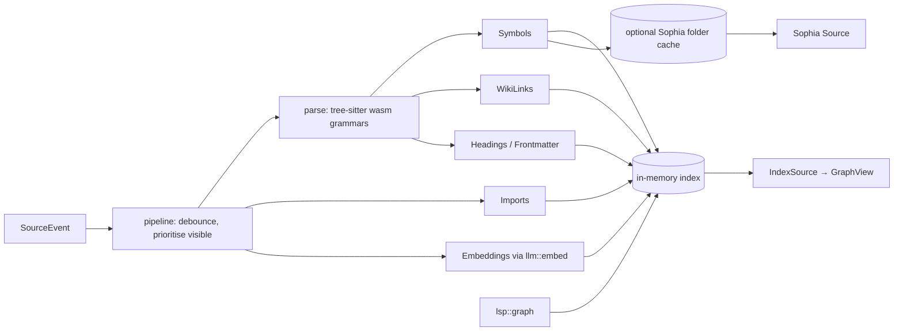

Crate: `index`. The index turns *files and rows* into a *graph* by deriving what sources don't know: symbols, links, outlines, embeddings, stack frames. It is exposed as `IndexSource`, so its output is just more nodes and edges.

> [!note] Index rechecked 2026-10-24 (WP-21/WP-65/WP-22/WP-66)
> - **Extractors**: wiki-links and tree-sitter definitions for Rust, Julia and Python. The three languages run through the same dispatch. Definitions have location ids, names, ranged occurrences, lexical containment and provenance; syntactic calls/references/imports resolve unique same-file names and preserve other targets as `Unresolved`. See [[Code Graph Schema]] for exact coverage and limitations. No headings/front matter nodes yet.
> - **Parsing** is native tree-sitter through `arborium` (shared with the Rust code editor, P-113) — not `.wasm` grammars; the index runs on desktop and the server, and the web/phone query the server's.
> - **Default storage is memory**: graph, BM25 postings (`search.rs`) and embeddings (brute-force cosine, reciprocal-rank fusion) rebuild on open. Default-off `sophia` now adds a derived SQLite code store per folder, reused on reopen (below; ADR-0029). No tantivy, usearch or recoco dependency.
> - **Content identities**: experimental `moonkale-index/content-ids`, off by default. Explicit async requests hash normalized Rust/Julia/Python syntax and same-file recursive dependencies; a bounded memory cache and optional state-store adapter are available. Unsupported syntax fails explicitly. No eager workspace hashing or UI activation. See [[Code Graph Schema]] for normalizer v7 and its conservative syntax subset.
> - **Rust L1 foundation**: default-off `lossless-syntax` snapshots preserve exact bytes/trivia and return guarded pure patch plans. The separate default-off `structural-edits` host feature now connects these plans to revision-aware document buffers and graph preview/conflict controls on desktop/web, plus complete same-folder reference-aware Rename via the existing LSP manager (coordinated buffer history, separate per-file saves); see [[Rust Lossless Syntax and Patches]].
> - **LSP as a second extractor** and the `precision` field are not built.
> - Stack traces live in their own crate, `moonkale-trace` (`TraceSource`), not in `index::trace`.

## Sophia folder cache (WP-21, implemented 2026-10-24)

With the default-off `sophia` feature, opening a folder writes the index's code
records into `.moonkale/code.sophia` (SQLite, enforced derived mode). The existing
in-memory index and its search remain available. The extra Sophia Source offers
names, definitions, references, generic Calls, SQL and Sophia queries to the
graph view and agent. It is read-only and declares file truth (ADR-0029).

Only the index's admitted Rust/Julia/Python code enters it: not hidden or
ignored, under 512 KiB per file; 5,000 walked files and 64 MiB aggregate bound.
Metadata files are read only for naming, never copied into the store. The walk
explicitly excludes `.moonkale/`; the cache adds its own ignore file.
Reopen hashes text against manifests and skips unchanged code without parsing
or ingesting it. Julia uses the shared module/include resolver; its dependants
are recomputed when needed and only changed manifests are written. Rust uses
nearest Cargo package names and conventional file modules; Python uses package
roots. Nonstandard Rust `#[path]` / custom target module trees are not inferred
by this first writer. Shared naming and content-id limits remain authoritative.

One watcher debounce window crosses `Source::refresh_batch` and the server
proxy intact, then becomes one `replace_files` transaction, including both
sides of a rename. Structured name conflicts add owners with a 16-owner bound;
empty/repeated owners fail visibly. Normalizer mismatch rebuilds the derived
cache. Removing it loses no authored content. Sophia manifest @1 owns facts
and their per-file reference counts, including atomic rollback.

The adapter checks current file hashes on text fetch. Matching definitions use
exact source spans; stale spans fall back to the current whole file and mark
the path stale. No reprinted code is written back. A derived reader reopens
its cache connection per call so it can follow cache recreation. Rebuilding
preserves definition content ids and names; generic nominal ids are allocated
by Sophia and may change. This does not yet make Sophia the default backend
or complete ADR-0029's release/default gates.

Rust acceptance tests live in `packages/services/index/tests/folder_store.rs`;
producer/mapping details in `packages/services/index/index.md`, reader details
in `packages/sources/sophia/sources-sophia.md`. Reproduce the repository
measurement with `cargo run -p moonkale-index --example folder_store --features
sophia -- .` (native debug; reads current working-tree code).

## Decisions
- **tree-sitter grammars as `.wasm`** — one artefact for desktop, web and mobile; contributed by language extensions ([[Contribution Points]]).
- **Two symbol extractors**: tree-sitter (fast, always available, approximate) and LSP (precise, needs a server). Derived edges carry `precision`; views prefer LSP when both exist.
- **Incremental by node**: a change re-runs extractors for that node only and re-links only its edges. Priority goes to nodes that are visible in some editor.
- **Storage is native/server**: `tantivy` + `usearch` don't target the browser; the web build queries the server's index. Parsing still runs client-side for highlighting.
- **Sophia** is the persisted code graph and query engine (ADR-0029). Recoco/Thread remain requirements prior art, not pipeline dependencies.

## Stack traces and ASTs
`index::trace` parses rustc/Julia/Go/Python trace formats into `Frame` nodes with `Calls` edges, linked to `Symbol` nodes. A panic in the [[Terminal]] becomes a clickable subgraph in the [[Graph View]] with a hierarchical layout. Function ASTs are the tree-sitter tree exposed as a `GraphView` (nodes = syntax nodes) — free once parsing exists.

## Embeddings and RAG
See [[LLM and RAG]]. Chunking is per symbol / heading / row; vectors are stored locally (`usearch`) or in the source when it has `VECTOR` (`pgvector`, HelixDB). Hybrid search = BM25 (`tantivy`) ∪ vector, fused.

## WP-21 repository measurement (2026-10-24)

Measured on this Linux worktree at master `9bedc5ab` plus WP-21, native **debug**
build, Sophia `c3c48e02`, fresh cache, owned target/slot and shared benchmark lock. The example reopens the
folder Source and rereads code on both passes; these are folder-store times,
not full UI startup times. Browser servers were stopped for the measurement.

| pass | total | walk/read snapshot | hash/produce/store | store size | parsed / replaced / skipped |
|---|---:|---:|---:|---:|---|
| cold build | 8.830 s | 0.729 s | 8.101 s | 36,704,256 bytes | 478 / 478 / 0 |
| reopen | 0.664 s | 0.635 s | 0.030 s | 36,704,256 bytes | 0 / 0 / 478 |

The snapshot was 6,111,526 source bytes. The cold pass added 4,962 distinct
records, 5,552 names, 3,740 memberships and three generic-call facts. It refused
2,787 definitions outside the conservative normal form and reported 12 ambiguous
named bindings (including conditional `SERVICES` definitions). Ambiguous names
are omitted rather than arbitrarily choosing a conditional branch; records
remain available. `folder_store_report` and the index root's
`sophia_refused` / `sophia_naming_diagnostics` properties report such partial
coverage. Timing columns are rounded independently. These are observations, not performance assertions or proof of full
repository/compiler coverage. Evidence: `target/next17-measured-final.log`.

Verification: all 18 mandatory/feature gate commands passed in
`target/next17-verified-gates.log` (826 workspace tests, seven ignored;
73 feature-focused tests, including ten folder-store regressions). Browser
`sophia-folder`, `graph`, `watch` and `search-trace` pass with the feature enabled
on owned port 8117; the renderer suites use Chromium/SwiftShader.

## ADR-0029 gate 4: history replay (2026-10-24)

**Rerun with the P-231 fix: clean.** Sophia `77f5c1c9` (tagged v0.1.1,
`def22b0c`, now pinned) fixes both causes of P-231: duplicate old member ids, and
names changing kind. With the same tool, checker `full-digest-v1` and debug
build, both histories show **0 differences at every checkpoint**, with no write
or fresh-build errors and no retries:

| repository | commits | batch median / p95 | sum of batch times | final store bytes | records / live facts |
|---|---:|---:|---:|---:|---:|
| moonkale (→ `edcf3c86`) | 469 | 122.1 / 932.9 ms | 119.6 s | 92,475,392 | 11,536 / 3 |
| lenticulum (→ `488ce636`) | 130 | 187.3 / 1089.2 ms | 49.3 s | 20,258,816 | 2,775 / 408 |

Final-checkpoint reads (median / p95 ms): Moonkale lookup 0.009 / 0.010,
text_source 4.78 / 5.95, All(1000) 6180 / 6226; Lenticulum lookup 0.006 / 0.007,
text_source 1.37 / 1.46, All(1000) 128.0 / 128.7. The All(1000) growth is
unchanged by the fix and still unprofiled. Raw reports:
`packages/services/index/measurements/history-2026-10-24-{moonkale,lenticulum}-77f5c1c9.jsonl`.
The run header now names the Sophia source from Cargo.lock.

The v0.1.0 run below is kept as the evidence for P-231.

### First run, Sophia v0.1.0

The opt-in `history_replay` example runs behind `sophia`; its shared test helper
also drives the hermetic five-commit CI test. Both real repositories were read
through Git blobs, without checkout or writes to either repository or Sophia's
checkout. Owned scratch/target directories, the heavy slot and the shared bench
lock were used. Native debug build, Sophia **v0.1.0 (`c3c48e02`)**, normalizer v7,
Linux, Rust 1.98.1. These are observed timings, not performance assertions.
Compilation/checks were excluded from the measured runs.

Each adjacent tree in reverse topological order is one watcher-shaped
`sync_selected` window, using the production `replace_files`/`NameClaimed`
retry path. The full eligible snapshot supplies dependency/owner recovery.
Only regular Rust/Julia/Python blobs and naming/ignore metadata are materialized;
the ordinary ignore-aware Source walk selects the code. Limits remain 512 KiB
per file, 5,000 walked files and 64 MiB admitted code. Unsupported/hidden/ignored
files, symlinks and internal cache/build directories do not enter the store.
This measures the folder writer, not OS event delivery or full app startup.
Equivalence checks consistency within today's conservative producer, not full
compiler-level definition/extraction coverage.

At every 50 commits and the end, a separate snapshot/store is built fresh.
Comparison covers full content ids/canonical bytes, actual names, text-source
pointers, file manifests, live generic memberships (including orphan relations),
and facts even on historical record subjects. Immutable historical records,
logs, randomly allocated nominal ids and first-writer display labels are
excluded from equivalence. Record counts below include retained history;
fact counts count actual live facts, not manifest claims. Differences are
reported without repairing or resynchronizing the incremental store.

| repository | commits | batch median / p95 | sum of batch times | retries | final store bytes | retained records / live facts | checkpoint differences / write or fresh-build errors |
|---|---:|---:|---:|---:|---:|---:|---:|
| moonkale | 467 | 105.462 / 795.053 ms | 106.232 s | 0 | 92,307,456 | 11,514 / 3 | 10 / 0 |
| lenticulum | 130 | 200.187 / 1193.086 ms | 54.676 s | 0 | 20,254,720 | 2,775 / 408 | 35 / 0 |

Ranges and evidence (JSONL contains every commit, count, error, difference and checkpoint timing):

- **moonkale**: `master`, `0bf404d7b42f998a06a3b28f09e1cf5b84df59f0` → `6d2afa4aaf2c63a8f501518747b4137acf3a5ee4`; [raw report](https://github.com/MathStruct/Moonkale/blob/master/packages/services/index/measurements/history-2026-10-24-moonkale.jsonl).
- **lenticulum**: `HEAD`, `6267a1576ec1d055572cdafb370903f018e7c31d` → `488ce636f193f95afb5ccbbbf92d34ea711e5e2a`; [raw report](https://github.com/MathStruct/Moonkale/blob/master/packages/services/index/measurements/history-2026-10-24-lenticulum.jsonl).

Checkpoint queries use 100 name resolutions, 100 fixed-seed random definition
`text_source` reads with replacement (seed `4d6f6f6e6b616c65`), and ten graph
`Source::query(All { limit: 1000 })` reads. Each cell below is median / p95 in
milliseconds. p95 uses nearest rank. Empty stores have no lookup/text samples.
These graph reads are capped snapshots, not whole-store traversal timings.

| repository / checkpoint | name lookup | text_source | graph All(1000) |
|---|---:|---:|---:|
| moonkale / 50 | 0.006 / 0.007 | 0.859 / 0.936 | 503.495 / 511.265 |
| moonkale / 100 | 0.007 / 0.007 | 1.076 / 1.176 | 745.031 / 747.243 |
| moonkale / 150 | 0.006 / 0.007 | 1.318 / 1.380 | 1070.522 / 1074.204 |
| moonkale / 200 | 0.007 / 0.007 | 1.464 / 1.537 | 1225.233 / 1231.006 |
| moonkale / 250 | 0.007 / 0.007 | 2.433 / 2.574 | 2734.605 / 2749.230 |
| moonkale / 300 | 0.007 / 0.007 | 2.522 / 2.669 | 2895.382 / 2949.424 |
| moonkale / 350 | 0.007 / 0.008 | 2.826 / 3.023 | 3310.263 / 3356.621 |
| moonkale / 400 | 0.009 / 0.010 | 4.592 / 5.891 | 5986.299 / 6013.897 |
| moonkale / 450 | 0.009 / 0.010 | 5.004 / 6.206 | 6161.308 / 6257.106 |
| moonkale / 467 | 0.009 / 0.010 | 4.782 / 6.017 | 6240.104 / 6372.789 |
| lenticulum / 50 | 0.006 / 0.007 | 0.754 / 0.787 | 67.256 / 68.306 |
| lenticulum / 100 | 0.006 / 0.007 | 1.205 / 1.318 | 110.904 / 111.521 |
| lenticulum / 130 | 0.007 / 0.007 | 1.357 / 1.458 | 127.903 / 129.483 |

The actual Search-panel read (`Text { dialect: "search", text: "main" }`,
ten attempts per checkpoint) is **unsupported** by SophiaSource. The raw reports
record its rejection latency and error; these are not successful search
measurements. Graph-read errors, if any, are separate checkpoint fields.
Search still uses the existing in-memory index, not this Sophia read path.

**Findings — gate 4 remains unmet.** P-231 affects both Rust and Julia:
Sophia deduplicates new generic contributions by content id but subtracts
repeated old manifest ids without deduplicating. Live generic names/members
can disappear even though file manifests agree. Old nominal relations can also
remain orphaned after a name becomes Content; that transition needs upstream
review. The exact request is in `HANDOFF-from-codex.md`; a minimal ignored
contract regression fails on v0.1.0. No cache repair or workaround is included.

Checkpoint difference counts are counts of differing state keys, not independent
bugs (a missing generic can affect its name and membership, and a persistent
error can recur at later checkpoints). Exact commits and owning paths are in
the raw reports. Differing checkpoints:

- moonkale #300 `2fe0c7f216c965f90ac2241a3494072d540f5071`: 2 differing keys.
- moonkale #350 `5a2cb07de26b793e0ad29ee18d3f589d2a679242`: 2 differing keys.
- moonkale #400 `48d17bff874a2fabd94e35202592135568280ad4`: 2 differing keys.
- moonkale #450 `02bf57ba285c537a18fb9bc0730966488defe27f`: 2 differing keys.
- moonkale #467 `6d2afa4aaf2c63a8f501518747b4137acf3a5ee4`: 2 differing keys.
- lenticulum #50 `cf7e331b23fb3464004ac8b1cd4ab36a97a85fc4`: 1 differing keys.
- lenticulum #100 `53b8b15b29ce0cf0698d4f7cc99271fbac3332ac`: 10 differing keys.
- lenticulum #130 `488ce636f193f95afb5ccbbbf92d34ea711e5e2a`: 24 differing keys.

All reported differences are name/membership keys: Moonkale has five missing
name keys and five missing membership keys across its checkpoints; Lenticulum
has 13 name and 22 membership differences. No content-record, manifest,
text-source or stored-fact differences were observed. A `paths=[]` orphan has
no current owning file manifest; its full member id and commit remain in the
report. The orphan is already present at Lenticulum checkpoint 50.

The fixed graph read gets slower across Moonkale's replay: median 503 ms at
checkpoint 50 and 6,240 ms at the end (p95 6,373 ms), despite its 1,000-node cap.
This is a debug observation against the accumulated store, not a full UI
measurement or a diagnosed cause; profiling the retained-history read path is
follow-up work. Lenticulum ends at 128 ms median / 129 ms p95.

Verification: all mandatory AGENTS gates passed, including separate fuzz fmt,
826 workspace tests (seven ignored), clippy, both distribution checks, rustdoc
and wasm. Sophia feature tests pass (74 tests, one ignored), including the new
five-commit replay, non-root range and scratch-refusal checks. Feature clippy
passes after fixing a byte-slice style lint in the new helper. The explicitly
run ignored P-231 contract regression fails as expected with two missing state
keys. Evidence: `target/next18-gates.log`, `target/next18-final-checks.log`,
`target/next18-p231-regression.log`, and the two checked-in JSONL reports above.
No production UI changed, so no browser suite was added or rerun.
