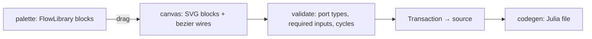

Crate: `editors/flow`. Drag-and-drop blocks wired by typed ports. First target from the brief: **build Lux.jl models by drag and drop**; then ModelingToolkit.jl acausal components.

## Model
A flow is ordinary graph data: `Block` nodes, `Custom("flow.wire")` edges, port info in properties. It lives in any source (a folder as `.flow.json`, or rows in a database) and is visible in the [[Graph View]]. The flow editor adds what a generic graph view can't: a **schema** (block kinds with typed ports), snapping, validation and a palette.

## Block libraries are contributions
`FlowLibrary { blocks: Vec<BlockKind>, codegen }` from an extension. Lux.jl library: `Dense`, `Conv`, `Chain`, `Parallel`, activations, loss, optimiser; port types carry tensor shapes with a small unification so a shape mismatch is a red wire. MTK library: components with physical-unit ports and `connect` semantics.

## Codegen is a command
`flow.generate` produces files (`model.jl` with a `Chain(...)` and a training scaffold; MTK: `@named` components + `connect` equations). Being a command, it's also an LLM tool ([[LLM and RAG]]) — "wire a CNN for MNIST" becomes a transaction on the flow graph plus a codegen call.

## Rendering
**Candidate canvas: [[dioxus-flow]]** (react-flow for Dioxus, same author as `dioxus-workbench`): handles, connections, layered auto-layout, custom node views — evaluated 2026-09-17, recommended for Phase 5. Otherwise SVG/Dioxus for typical flows (blocks need rich editable content: parameter fields, previews). Very large flows can fall back to the graph renderer's surface later.

> [!success] Canvas superseded by ADR-0018 (2026-10-08)
> `dioxus-flow` stays the canvas until the graph engine's edit mode reaches parity (spec [[031]], stage 7 of [[Frontend Graph Engine Mapping]]), then it is replaced by our own flow editor extension over `graph-render` — we do not own the dioxus-flow repository, so the substantial changes spec 031 needs (ports as hit targets, orthogonal routing, LOD, scale) belong in our own engine. The flow **model** (`ext-api::flow`) is already frontend-agnostic and does not move.

> [!success] Canvas swapped (stage 7b, 2026-10-09; parity closed in 7c)
> The panel draws on the graph engine (`graph-render`, spec [[031]]): pinned rect blocks, typed ports, ortho wires, `connect` validated in the panel with `unify`, one HTML parameter editor floating beside the selected block (positioned from the engine's screen reports), undo/redo (Ctrl+Z/Y) as document-JSON snapshots, `Layout` via `hier_layout`. **dioxus-flow is fully retired** — its dependency, its CSS, everything; the model (`ext-api::flow`) never moved.

> [!success] Built in Milestone 6 ([[Milestone 6 - Implementation Log]])
> `editors/flow` on [[dioxus-flow]] 0.1.2, opt-in; the model (`PortType`/`unify`, `BlockKind`, `FlowLibrary`, `Flow` JSON, `validate`) lives in `ext-api::flow` so libraries are contributions from other extensions; `extensions/lux` is the first (Input/Dense/Conv/MaxPool/Flatten/Dropout/BatchNorm/Loss/Optimiser → `model.jl`). Flows are `*.flow.json` files. Phase 1 and the codegen half of phase 2 are done; running through the terminal with errors linked to blocks, and the MTK library, are next. Notes: [flow.md](https://github.com/MathStruct/Moonkale/blob/master/packages/editors/flow/flow.md), [lux.md](https://github.com/MathStruct/Moonkale/blob/master/packages/extensions/lux/lux.md).

## Beyond Lux: MTK and Lenticulum
Undirected pins are in the model (ADR-0020, 2026-10-12): `BlockKind.connections` — acausal, domain-typed pins, wires in either order, buses allowed, equation loops legal. The **ModelingToolkit library exists** (same date, in [`MathStruct/moonkale-julia`](https://github.com/MathStruct/moonkale-julia)): Resistor/Capacitor/Inductor/Voltage/Ground and Mass/Spring/Damper/Fixed, `circuit.jl` codegen — `@named` components, the pin wires grouped into nets (a bus is one `connect`), `structural_simplify` and a solved ODE problem; the `mtk.mjs` e2e builds an RC low-pass, checks the generation against a golden file and simulates it (99.3 % after 5τ). **Subflows are in the model and drawn (ADR-0021 stage A, 2026-10-13):** `Flow::subflows` + `Block.subflow` (`ext-api-2026-10-13`), a subflow's declared boundary ports are the parent block's ports through one resolution site (`Flow::ports_of`), wires into a subsystem validate like any block's, and the panel draws the subsystem as one block. **Stage B is built (ADR-0021, 2026-10-13):** editing is a scope stack in the panel — a double-click on a subsystem block enters its subflow (a plain `set_graph` scene swap), a breadcrumb names the stack, and Escape or an empty-canvas click pops out; the palette, toolbar, status bar and mutators serve whichever scope is open; undo/redo are unchanged (a snapshot is the whole document, so an inner edit restores with the parent intact — a scope the restored document no longer holds pops off). Inside, each declared boundary port is a pseudo-block (`boundary/<port>` — synthesized by the panel, never stored): an input on the left edge (a source inside), an output on the right (a sink), a pin on the top. The palette's **Subsystem** button creates a subflow you enter and fill; declaring boundary ports is deliberately still a file-level concern (the ADR leaves that UX open). `validate` now looks inside subflows — wire type-checks through the boundary, required ports fed from inside, inner cycles — so a broken inner wire surfaces before codegen (issues are about `subflow/id`). **Stage C is built (2026-10-13, moonkale-julia v0.3.0):** Generate flattens — an MTK subsystem inlines into the parent circuit with per-instance names (`rc_filter_1_resistor_1`; `_`, because ModelingToolkit reads `₊` as its own namespace), each boundary pin merging its inner net with the parent's (both sides must be wired), nested subsystems recurse, and the one-library rule covers the inside; a Lux subflow with one input and one output splices its layer path into the parent `Chain`. `mtk.mjs` opens an RC whose filter is one subsystem, checks the generation against a golden file and simulates it to the same 99.3 %. **The bipartite rule is in (ADR-0022 stage A, 2026-10-13):** a library marks its kinds as variables or factors (`BlockKind.role`). The wire gesture then refuses factor–factor and variable–variable wires and a second variable on one factor channel, `validate` reports the same in a file, and variables draw as circles. **The RxInfer library is built (ADR-0022 stage B, 2026-10-13, moonkale-julia v0.4.0):** a variable (a circle labelled with its name; data makes it observed) and Beta, Bernoulli, Normal (variance or precision), Gamma and Poisson factors. Generate writes `inference.jl`: an `@model` whose arguments are the observed variables, one `~` per factor in graph order (an i.i.d. data vector runs in a loop), and `infer` printing every latent posterior. It is exact message passing, and mean-field variational when a factor has two latent inputs. `rxinfer.mjs` builds a coin's bias in the panel and infers the exact Beta(9, 10). **Blocks draw as symbols (ADR-0024, 2026-10-14):** a kind may carry a `Symbol`, which is SVG path data with each pin anchored to a side. The panel draws it as a schematic: a capacitor's plates, a resistor's box, ground's bars, a spring's zigzag, a damper's dashpot. The label sits beneath. ModelingToolkit draws all its parts, and RxInfer's factors show their densities. Without a symbol, pins no longer hang off the top: acausal pins alternate left and right, and a factor's parameters come in from the left with its variable leaving on the right. Wires leave each pin along its side and detour round the parts when the pins face away from each other. **Blocks turn, mirror and carry captions (ADR-0024 §5–6, same day).** R turns the selected blocks a quarter clockwise, and M mirrors them; the block editor has both as buttons. The file keeps `turn` and `mirror`, and the pins turn with the drawing. A kind's caption template shows a value line under the name: `1.0 Ω` for a resistor, `θ ~ Beta(2, 7)` for a factor, where a wired channel shows its variable's name. What remains for the rung is a subsystem as one factor and Lenticulum's edge directions (stage C), then Lenticulum — the goal behind Moonkale ([[Julia and Lenticulum]]).

## Phases
1. Canvas, palette, wires, validation, save/load as nodes.
2. Lux.jl library + codegen; run via [[Terminal]] (`julia model.jl`) with errors linked back to blocks.
3. MTK library — **done 2026-10-12** (ADR-0020's pins + the library in moonkale-julia; `mtk.mjs` builds and simulates an RC circuit).
4. Execute-in-place (Julia kernel) — research.
