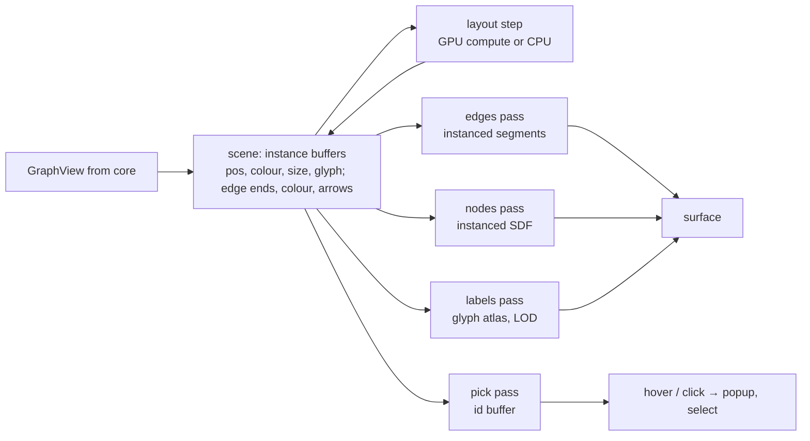

Crate: `editors/graph`. The requirement that shapes it: **fluid at 100k+ nodes** — the brief calls out that Obsidian's graph becomes slow past a certain size. See [[Graph Rendering Options]] for the option survey and [[ADR-0003 wgpu for graph rendering]] for the decision.

## Pipeline

## Requirements → mechanisms
| Requirement (from brief) | Mechanism |
|---|---|
| GPU-native, fluid at scale | `wgpu`, instanced draws, GPU force layout (compute), LOD for labels/edges |
| Popup with node/edge content | pick buffer → `fetch(NodeId)` → popup (declarative `moonkale_shell::Tree` template from a `RendererContribution`, or custom Dioxus for static extensions) |
| Arrow colours / directions | per-edge colour + arrowhead flags in the instance buffer; colour by kind, source, property, or extension style |
| Subgraphs | `subgraph` module: expand/collapse neighbourhoods (issues `Query::Neighbours`), filters, isolate selection, saved views stored as nodes |
| 3D | same buffers; perspective camera; z from layout or a property (time, layer); depth-sorted edges, fog. Stereo and headsets (OpenXR, WebXR) are planned in [[3D Graphs on Monitors and in Headsets]] |

## Layouts
- **GPU force-directed** (grid-binned or Barnes-Hut repulsion in compute shaders): the 100k-node path. Requires WebGPU (compute).
- **CPU force-directed** (`fdg-sim` or own): WebGL2 fallback; degrades past ~10k.
- **Hierarchical** (layered): call graphs, ASTs, ML models, stack traces.
- **Radial / concentric**: local graph around a node. Local graphs per document, linked to their content and marked by a shared tab colour: [[Linked Panels]] (planned 2026-10-14).
- Positions are persisted per saved view; re-opening doesn't reshuffle.

## The platform problem: where does the surface come from?
The renderer is written once against `wgpu`. The **surface** differs:

| Platform | Strategy | Status |
|---|---|---|
| Web | `<canvas>` + WebGPU; WebGL2 fallback (no compute → CPU layout) | straightforward |
| Mobile webviews | `<canvas>` + WebGL2 (WebGPU unreliable) | CPU layout only |
| Desktop **webview** | (a) same as web *inside* the webview — WebGPU: WebView2 ✅, WKWebView ✅ (recent), WebKitGTK ⚠️ not by default; (b) native wgpu child window/overlay composited over the webview; (c) offscreen wgpu → texture stream into a canvas | **undecided**, biggest platform risk |
| Desktop **native** (`dioxus-native`/Blitz, future) | direct wgpu; trivial | blocked by JS deps ([[JS Interop Boundary]]) |

> [!note] Milestone 8: **3D** is a mode of the same renderer — z per node kind (`layer_z`), a perspective camera orbiting the layout, depth-tested fogged edges, screen-space node size attenuated by depth; toggle in the toolbar. Tested in Chromium with SwiftShader (`graph3d.mjs`).

> [!note] Milestone 6: the CPU layout is Barnes–Hut (θ = 0.8) above 1 500 nodes — 100k nodes at ~170 ms/step natively, ~190 ms/step as wasm in Firefox ([[Milestone 6 - Implementation Log]]) — so "CPU layout only" is no longer a blocker; GPU compute stays deferred.

Recommendation: ship (a) with WebGL2 fallback first — it's one code path and works *somewhere* on every platform; measure; only then consider (b) for Linux/WebKitGTK. Details and measurements go in [[P-001 Graph surface in desktop webview]].

## Big cases
Backend chosen by measured size — see [[Case Selector]] (design).

## Interaction
Pan/zoom/orbit, click/box/lasso select, drag-to-pin, hover popup (debounced pick readback), keyboard navigation along edges, double-click → open node in its editor. Minimap.

## Styling
`NodeStyle`/`EdgeStyle` resolved from renderer contributions + user overrides; colour by kind / source / property / community; theme-aware ([[Contribution Points]] → theme).

## Phases
1. 2D, instanced nodes/edges, CPU layout, pick, popup, WebGL2 + WebGPU — ≤10k nodes.
2. Labels with LOD, styles, subgraph ops, saved views.
3. GPU compute layout; 100k target; desktop surface decision.
4. 3D.

## Spec 031 — the frontend graph engine (2026-10-08)
[[031]] turns this view into the **one** frontend graph engine — layered, port- and route-aware, shared by graph exploration and flow editing (ADR-0018). The requirements are mapped onto this crate with a staged plan in [[Frontend Graph Engine Mapping]]; implementation notes per stage live in the crate note (`packages/graph-render/graph-render.md`). Built so far:

- **Stage 0 — persistent instance buffers**: geometry/appearance split per pipeline, revision-gated uploads; 100 k nodes settle at 1.14 ms per drawn frame (`bench-draw.mjs`).
- **Stage 1 — edges and selection**: `frame.rs` tessellates edges into segments (parallel fan-out, self-loop rings, dashes, widths), arrowheads for directed edges, `edge_at` picking; selection by instance id with `select` events — a plain click picks a node, then an edge, then clears; Ctrl toggles; a released drag selects nothing. `graph-edges.mjs` covers it; the shader is validated natively (naga, P-158).
- **Stage 2 — ports and edit mode**: `InPort` on the wire format (side/offset/direction), edges anchor at their ports, ports draw in edit mode only, and a wire dragged between ports emits `connect` — the host validates and adds the edge. `set_interaction("explore"|"edit")` switches modes on the same renderer without touching the camera (`set_mode` stays 2D/3D). `graph-edit.mjs` covers it.

- **Stage 3 — layers and traces**: `InLayer` (visibility + style) and `InTrace` (ordered node-id walks) on the wire format; a shared edge draws one offset stroke per visible layer, traces carry a head per hop and keep recursion order, hidden layers remove their strokes and answer no hits — never touching topology. `graph-layers.mjs` covers the blue-calls + yellow-trace acceptance.

- **Stage 4a — delta updates**: `apply_delta(json)` next to `set_graph` — `add_nodes`/`remove_nodes`/`add_edges`/`remove_edges`, all by instance id (edge endpoints name nodes by id, an edge whose endpoint is missing waits and re-resolves on a later delta). The camera and the id-keyed selection survive; the layout warms (temperature 3) around the survivors instead of restarting. This is the host's path for collapse/expand without re-sending the whole 100 k graph. `graph-delta.mjs` covers it.
- **Stage 4b — groups and LOD**: `InGroup { members: [node ids], color, visible }` on the wire and in deltas (`add_groups`/`remove_groups`) — one rounded-rect hull tints each group's region behind everything; nesting and overlapping memberships each keep their own tint. Collapse/expand is the host's delta (members out, aggregate in, group re-sent) — the renderer never mutates topology. `focus(ids)` fits the view to a subset. LOD is zoom-driven and shader-side: ports stop drawing under 2.5 px, dashes go solid on short segments, hulls fade below 14 px. `graph-groups.mjs` covers it with hue-based pixel checks.
- **Stage 5 — higher-order edges**: `InHyperedge` (a junction marker at the members' centroid with spokes — presentation, never picked as edges), `InSimplex` (a filled face, fanned for more than three members), and `InGroup.highlight` (a clique: a visual membership wearing twice the tint and a bright rim) — three distinct classes over the same nodes, all carried by deltas. `graph-higher.mjs` shows them side by side.
- **Stage 6 — pulses**: `InEdge.pulse_speed` (world units per second) moves a glow along the stroke entirely in the shader — the view redraws continuously while any edge pulses, and segments under 8 screen px stop glowing (§6). `graph-pulse.mjs` measures the motion at two speeds.

- **Stage 7a — the flow shapes**: rect block nodes (`shape: "rect"`, `width`/`height` half-extents) with ports riding the sides, `Route::Ortho` step wires, `hier_layout` (longest-path columns, rows stacked, everything pinned — the flow document owns positions) and `node_positions()` to harvest them back. `graph-flow.mjs` covers it.

- **Stage 7b — the flow panel**: `packages/editors/flow` hosts this engine instead of `dioxus-flow` (ADR-0018) — blocks as pinned rect nodes, typed ports left/right, ortho wires, `connect` validated in the panel (`unify`, one wire per input), `moved` harvested back, one HTML parameter editor for the selected block (§7), the panel refits when the scene grows beyond the fitted box. The fit now carries node rims (`bounds_with_rims`) — a block's half-width dwarfs the fit pad and put the outer ports off the canvas. `flow.mjs` rewritten against the engine.

- **Stage 7c — parity closed**: undo/redo (document-JSON snapshots, Ctrl+Z/Y — a field's Ctrl+Z stays its native text undo, spec 001), the parameter editor floating beside its block (positioned from the engine's `select`/`moved` screen reports), and the dioxus-flow remnants deleted. Engine-side: a pinned node with `pos` is the host's to move (undo restores coordinates on the canvas), and events carry their payloads (`select`/`moved` include screen positions) because a host cannot call back into the view from inside an event — the state borrow is held.

- **Stage 8 — the §2 presentation gaps**: a third shape (`shape: "diamond"` — half-extents and side ports like a rect, the lit area the inscribed rhombus), a host stroke (`stroke: "#rrggbb"` — a ~2 px band inside the rim; selection's ring wins), and node icons (`icon` — a glyph on the label overlay, hovered/selected nodes only, ink contrasting the node's fill). Hovers now patch two instance slots instead of re-uploading the whole appearance buffer (§6's partial buffer updates — hover at 100 k: 0.97 → 0.29 ms/frame). `graph-shapes.mjs` covers it.

- **Stage 9 — edge labels on hover**: `InEdge.label` (on the wire since stage 1) now renders — hovering a stroke (no node hovered) draws the edge's label beside the pointer, inked in the edge's colour; the per-move scan is gated on graphs that carry labels. Also fixed the asset pipeline (P-171): dx served the engine one build behind because the asset URL hash never recompiled — `build.rs` now keys the asset crate on the wasm's bytes.

- **Stage 10 — the accessibility minimums**: the overlay is keyboard-focusable (the engine sets the tabindex and focuses the canvas on click — its own pointerdown prevents the default); the arrows walk spatially (nearest node in a 45° cone), Enter selects the focused node, Escape clears, Tab stays the browser's. The focus is id-keyed, wears a ring on the overlay and emits `focus { id }`; the panel narrates the selection and focus through an `aria-live` line. `graph-a11y.mjs` covers it.

`dioxus-flow` is retired (ADR-0018): typed ports, auto-layout, undo, parameter editing, the Lux blocks unchanged, the broken-file guard — all on the one engine.

## Experimental Rust structural edits

Desktop and web builds with the default-off `structural-edits` feature offer
**Edit Rust function (experimental)** for a selected Rust function definition.
Explicit declaration-name, reference-aware same-folder rename and same-file move controls lead to an escaped,
range-highlighted preview. Apply changes the open unsaved buffer through its
normal undo history; it does not save. Conflicts retain the old preview beside
current source and require recomputation and fresh function confirmation.
Dragging continues to arrange the graph. Rename uses rust-analyzer with two-pass target preparation, complete per-file previews, coordinated keyboard/menu/review undo and separate per-file saving. Cross-source plans are refused in full. Nested
operations, Store writes and cross-file moves are not provided. See
[[Rust Lossless Syntax and Patches]] for limits, platform wiring and tests.

## E-graphs (WP-07, 2026-10-23)

Open the Graph panel's **Paste trace** dialog, paste a plain engine e-graph JSON
snapshot, and choose **Draw e-graph JSON**. For an example use
`packages/graph-render/fixtures/egraph.json`; the exact mapping is documented in
`packages/graph-render/graph-render.md` and [[North Star]]. This is an in-memory
view, not a file opener or an editable code store. **Back to sources** reloads
the normal source view; the pasted snapshot is not persisted.

The class picker offers per-class collapse/expand, alongside all-class controls.
An expanded class is a group containing its anchor and equivalent operators;
collapse keeps the class endpoint with its representative operator label.
Child edges always address classes. The **Rewrite provenance** checkbox hides
or shows rewrite edges; selecting an operator highlights the incoming rewrite
chain, and hovering a rewrite edge shows the rule name. Selection remains
separate from that highlight. Single-class and all-class operations keep the
camera and restore hidden members' positions. Snapshots are capped at 4 MiB,
4096 nodes, 32768 edges and 4096 groups. Live producer integration remains open.
