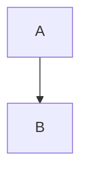

# Code

```rust title="main.rs"
fn main() { println!("*not emphasis*"); }
```

~~~python
print("tilde fence")
~~~

````markdown
```
a fence inside a fence
```
````

    indented code block
    with two lines



Sentinel paragraph.

```tikz
\begin{tikzpicture}\draw (0,0) -- (1,1);\end{tikzpicture}
```

```typst
$ sum_(i=1)^n i $
```

```
<div>html inside code</div>
```
